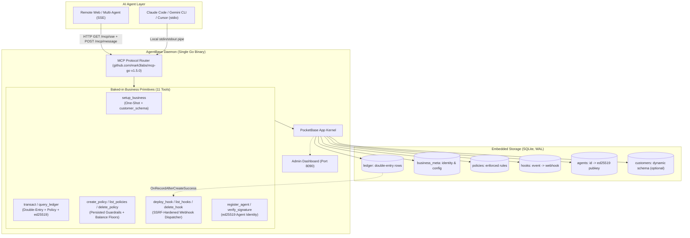

# AgentBase: AI-Native Backend & MCP Daemon Built on PocketBase

> **In this repository** the server lives in `mcp-workspace/`, named for the part most people will use: the eight
> `ws_` tools that give an agent a memory tied to evidence (section 3, "The workspace"). The program itself is
> still called `agentbase`: the binary, the Go module and the `AGENTBASE_*` environment variables keep that name.
> Build it from this folder with `go build -o agentbase .` (add `.exe` on Windows). The approval gate that knows
> its tools is [`../reference_agent/outbound.py`](../reference_agent/README.md).

A **compile-verified** blueprint for building, deploying, and operating an autonomous
business backend for AI agents. This document matches the reference
implementation in this repository (see [§6 Verification](#6-verification-what-was-actually-run)).

This architecture embeds a native **Model Context Protocol (MCP)** server directly
into the **PocketBase** Go kernel, giving local agents (via `stdio`) and remote agents
(via `SSE`) access to eleven business primitives: **single-shot deployment** (with optional
dynamic `customer_schema`), **double-entry ledger accounting** (with optional `ed25519` signatures),
**balance auditing**, **enforced runtime policy guardrails** (including balance floors),
**SSRF-hardened webhook dispatch**, and **cryptographic agent identities**.

> **Pinned versions** (verified against `go.mod`):
> `github.com/pocketbase/pocketbase v0.40.6`,
> `github.com/mark3labs/mcp-go v1.5.0`,
> `github.com/pocketbase/dbx v1.12.0`, built with **Go 1.27.4**.
> PocketBase has no backward-compatibility guarantee before v1.0, so **pin these
> versions** — the APIs below changed meaningfully across v0.22 → v0.23 → v0.40.

---

## 1. System Requirements & Architecture

* **Engine:** Embedded PocketBase Go framework with SQLite (WAL mode by default)
* **Transport:** Model Context Protocol (JSON-RPC 2.0 over `stdio` and HTTP/SSE)
* **Host Compatibility:** Linux, macOS, Windows (single native Go binary)



---

## 2. Project Directory Layout

```
mcp-workspace/                  # the Go module is named agentbase
├── apis/
│   ├── README.md               # What each file in this folder holds
│   ├── mcp.go                  # MCP server, the 11 ledger tools, HTTP/SSE mount + bearer auth
│   ├── business.go             # setup_business, customer_schema, transact, query_ledger
│   ├── policy.go               # Fail-closed policy parser, evaluator & balance-floor checks
│   ├── hooks.go                # SSRF-hardened webhook validation & DialContext IP pinning
│   ├── identity.go             # ed25519 agent key registration & signature verification
│   ├── workspace.go            # Workspace: anchored findings, unknowns, notes, results, file summaries (local only)
│   ├── workspace_mcp.go        # The 8 ws_ tools, registered only by EnableWorkspace
│   ├── workspace_usage.go      # ws_usage.jsonl: the bytes each workspace call costs, per session (sizes only)
│   ├── link_windows.go         # Is a path component a link? Reads the Windows reparse tag
│   ├── link_other.go           # The same check elsewhere: ModeSymlink
│   ├── policy_test.go          # Policy parser/evaluator & bearer auth unit tests
│   ├── ledger_test.go          # Ledger transaction, policy abort, hook & amount tests
│   ├── e2e_test.go             # JSON-RPC MCP, HTTP guard, SSRF redirect, schema & ed25519 tests
│   ├── nonce_test.go           # Signed-transfer replay protection and payload bytes
│   ├── guards_test.go          # Tests added by the break-it pass (see STANDARD.md)
│   ├── workspace_test.go       # Workspace tests, ground truth from git and hand-built files
│   ├── workspace_summary_test.go          # File summaries (FRESH/STALE), the brief, the 4000-byte note, the usage log
│   ├── link_test_helpers_windows_test.go  # Test helper: the Windows name-surrogate (reparse tag) check
│   └── link_test_helpers_other_test.go    # Test helper: the same check off Windows
├── main.go                     # Entrypoint: --ws-usage, stdio --mcp branch, web/SSE serve
├── go.mod                      # Module definition (pinned versions)
├── go.sum                      # Resolved dependency checksums
├── README.md                   # This file
├── STANDARD.md                 # Which test guards each guard, and the mutation that broke it
├── .gitignore                  # Keeps pb_data/ and the built binary out of git
└── pb_data/                    # Embedded SQLite database (generated at runtime, git-ignored)
```

To build it here, `go.mod` and `go.sum` already pin everything: `go build -o agentbase .` (see section 4).

How the module was first created, kept as a record (do not run these inside this repository: `go.mod` already
exists, and `go mod init` would start a second module):

```bash
mkdir agentbase && cd agentbase
go mod init agentbase
go get github.com/pocketbase/pocketbase@v0.40.6
go get github.com/mark3labs/mcp-go@v1.5.0
go mod tidy
```

---

## 3. Key Implementation Notes (and the v0.23+ gotchas)

| Concern | Wrong (pre-0.23 / drafted) | Correct (v0.40.6 / mcp-go v1.5.0) |
|---|---|---|
| Serve hook | `app.OnBeforeServe().Add(...)` | `app.OnServe().BindFunc(func(e) { ...; return e.Next() })` |
| Query expr | `types.HashExp{...}` | `dbx.HashExp{...}` (`import "github.com/pocketbase/dbx"`) |
| SSE mount | `sse.HandleSSE` without base path | `WithStaticBasePath("/mcp")` + `SSEHandler()` + `MessageHandler()` |
| Tool args | `req.Params.Arguments["x"].(string)` | `req.RequireString("x")` / `req.RequireFloat("x")` |
| Collection names | `_ledger`, `_business_meta` (`_` is reserved) | `ledger`, `business_meta`, `policies`, `hooks`, `agents`, `customers` |
| stdio startup | intercept inside a serve hook | branch on `--mcp` **before** `app.Start()`, call `app.Bootstrap()` |

### Design & Security Decisions

* **Policy enforcement fails CLOSED.** `create_policy` persists uniquely named rules to `policies`. `transact` evaluates every policy **inside the same SQLite transaction** before writing rows; DB load errors or unparseable stored rules abort immediately.
* **Balance-floor / overdraft prevention:** Rules support `field ∈ {amount, from_balance_after, from_account, to_account, account}` and `op ∈ {<=, >=, <, >, ==, !=}`. Adding `from_balance_after >= 0` enforces no-overdrafts atomically in-transaction.
* **Exact whole-number accounting:** `validateAmount` requires finite positive whole numbers up to `2^53` (the exact IEEE-754 integer boundary for JSON numbers); `query_ledger` aggregates exact `int64` sums and returns `[]` (never `null`) when empty. Self-transfers (`from == to`) are rejected.
* **SSRF-hardened webhooks:** Only `ledger.after_create` is accepted. Target hosts must appear in `AGENTBASE_HOOK_HOSTS`, URLs must be `https` (or `http` to localhost only with `AGENTBASE_ALLOW_HTTP_HOOKS=1`), HTTP 3xx redirects are blocked (`http.ErrUseLastResponse`), and `DialContext` checks every resolved IP at connect time and dials the checked IP rather than the name, so a second DNS answer cannot redirect the connection. A hook skipped at dispatch is logged with its record id and the reason; hook URLs and payloads are not logged.
* **Cryptographic agent identity:** `register_agent` stores `ed25519` public keys in `agents`; `verify_signature` checks a signature over any message. A signed `transact` needs `agent_id`, `signature` and `nonce` together. The signed bytes are the netstrings (`<byte length>:<value>,`) of `agentbase.transact.v2`, `agent_id`, `from_account`, `to_account`, `amount`, `memo`, `nonce`, in that order; for example agent `bot` sending 250 from `a` to `b` with memo `m` and nonce `n1` signs `21:agentbase.transact.v2,3:bot,1:a,1:b,3:250,1:m,2:n1,`. Each `(agent_id, nonce)` is accepted once: it is recorded in `agent_nonces` (unique index) inside the same transaction as the ledger rows, so a replay is refused and writes nothing, and a transfer that fails for any other reason does not use up its nonce. The earlier `from|to|amount|memo` form is no longer accepted: it had no nonce, so one signature could be replayed indefinitely, and the plain join was ambiguous (`a|b`->`c` and `a`->`b|c` signed the same bytes). A database created before `agent_nonces` existed refuses signed transfers until `setup_business` is run again.

### The workspace (local stdio only)

Eight `ws_` tools let an agent working on a project keep what it found, with
the evidence, so the next session does not have to find it again. They read
files, so `main.go` registers them only in `--mcp` (stdio) mode; the remote SSE
endpoint never has them, and a test checks that. So the stdio server offers 19
tools (the 11 ledger tools and these 8), and the remote server offers 11.

Add `--workspace-only` after `--mcp` for a session that only keeps its own work:
the stdio server then offers the 8 `ws_` tools and nothing else. Every tool
offered costs each session the tokens of its description. Measured on
2026-11-21 (this build, Windows, `tools/list` over stdio, the `tools` array as
compact JSON): 12,478 bytes for the 19 tools, 6,007 bytes for the 8 workspace
tools alone, so `--workspace-only` roughly halves it. (An earlier figure,
13,140 and 6,313 bytes, did not record how it was measured, and does not
reproduce this way.)

* `ws_brief` is where a session starts, in one call: the commit and whether the
  tree is clean, the last note and how many commits came after it, the open
  unknowns and the findings whose evidence MOVED, BROKE or is GONE (up to 20 of
  each, newest first, with `BROKEN` and `GONE` ahead of `MOVED`, plus
  `open_unknowns_more` / `needs_attention_more` when more are omitted), how many
  findings are in each state, which file summaries went stale, and the results
  recorded at this commit. A finding is shown by id, place, state and the head
  of its claim (its first sentence, at most 160 bytes), so the brief stays small
  however much is recorded; `ws_recall` with its path gives the whole claim.
* `ws_summarize` stores what a file is (its purpose, its main parts, where its
  guards are) for a later session to read instead of the file. It is tied to the
  file's blob hash: FRESH while the file is unchanged, STALE once it changes, and
  then the file must be read again. A summary must be shorter than its file and
  at most 2000 bytes; one per file, and a new one replaces the old. **FRESH means
  the file is the one that was summarized, not that the summary is right.**
* `ws_record` stores a finding (or an open question, kind `unknown`) with a
  file, a line range and words quoted exactly from those lines. It is refused
  if the quote is not there. The file's git blob hash and the whole evidence
  lines are stored with it.
* `ws_recall` checks every finding's evidence again: FRESH (the blob hash is
  unchanged), INTACT (the file changed elsewhere; the evidence lines are exactly
  as recorded, at the same lines), MOVED (the evidence is elsewhere in the file;
  `now_at` gives the lines, and `quote_occurs` says when it is in more than one
  place, so the new position is a guess), BROKEN (the quote is gone) or GONE
  (the file is gone). **FRESH means the evidence is unchanged, not that the
  claim is right.** Each file is read once per recall, however many findings
  and summaries point at it. The answer is `{"findings": [...], "summaries": [...]}`.
* `ws_resolve` closes an unknown with what was found. The question is kept.
* `ws_note` leaves a note for the next session, at most 4000 bytes, since every
  brief shows the latest one. Notes are only added.
* `ws_result` records a command's outcome. The caller passes `tested_at`, the
  commit it ran against; it is refused unless that is still HEAD and the tree
  has no uncommitted or untracked change. The brief shows a result only at that
  commit and while the same gitignored files and folders are present (by name,
  not content), because tests can read ignored data that a fresh clone lacks.
  That the tree was clean while the command ran is the caller's word: a run on
  a dirty tree that was cleaned before recording cannot be detected. The OS and
  architecture are added to the caller's `env`.
* `ws_register_project` names a project and its root. A path must stay inside
  the root: `..`, absolute paths, and any symlink or Windows junction on the
  way are refused. Since Go 1.23, `EvalSymlinks` does not resolve a junction
  while `os.Open` goes through one, so every path component is checked with
  `Lstat`, and on Windows the reparse tag is read: a symlink or junction (a
  name surrogate) is refused, while a OneDrive cloud placeholder, which is also
  a reparse point, is read as the file it is. What lies above the root is not
  checked, so a root reached through a junction can be registered.

**What the workspace costs, measured.** Every workspace call appends one line to
`ws_usage.jsonl` in the data directory: the tool, the project, the bytes sent
and returned, and a session id that is new each time the server starts. Only
sizes are written, never what was said. `agentbase.exe --ws-usage --dir <data>`
prints the totals per session. It sees only workspace calls, not the files a
session reads by other means, so compare its totals with the client's own token
count for the same session before concluding the workspace saved anything.

---

## 4. Compilation & Verification

```bash
go mod tidy
go build -o agentbase .
go vet ./...
go test -v ./apis/
```

Verify the binary speaks JSON-RPC 2.0 MCP over stdin (note: **no `serve`
subcommand** — the `--mcp` flag is intercepted before cobra):

```bash
printf '%s\n%s\n' \
'{"jsonrpc":"2.0","id":1,"method":"initialize","params":{"protocolVersion":"2024-11-05","capabilities":{},"clientInfo":{"name":"test","version":"1.0"}}}' \
'{"jsonrpc":"2.0","id":2,"method":"tools/list"}' \
| ./agentbase --mcp --dir=./pb_data
```

---

## 5. Client Integration

### A. Local Stdio (Claude Code, Cursor, Gemini CLI)

`mcp_servers.json`:

```json
{
  "mcpServers": {
    "agentbase": {
      "command": "/absolute/path/to/agentbase",
      "args": ["--mcp", "--dir=/absolute/path/to/pb_data"]
    }
  }
}
```

### B. Remote Network (Multi-Agent & Web UI)

Remote MCP is **authenticated and fails closed**: `/mcp/sse` and `/mcp/message`
return `403` unless `AGENTBASE_API_KEY` is set, and every request must carry
`Authorization: Bearer <key>` (SHA-256 constant-time comparison; wrong/missing
tokens return `401`). Set `AGENTBASE_BASE_URL` only if an explicit external origin
is needed behind a proxy (defaults to relative `/mcp/message`).

```bash
export AGENTBASE_API_KEY="$(openssl rand -hex 32)"   # required to enable remote MCP
export AGENTBASE_HOOK_HOSTS="hooks.example.com"      # optional webhook host allowlist
./agentbase serve --http=127.0.0.1:8090
```

* **Human Admin UI:** `http://127.0.0.1:8090/_/`
* **Remote Agent SSE Endpoint:** `http://127.0.0.1:8090/mcp/sse`
* **SSE Message POST Endpoint:** `http://127.0.0.1:8090/mcp/message`

---

## 6. Verification (what was actually run)

Run `go test -count=1 -race ./...`. Which guard each test protects, and the
mutation that was shown to make it fail, is in [STANDARD.md](STANDARD.md).

---

## 7. Known Limitations

* The policy evaluator is single-clause (`<field> <op> <value>`); register multiple
  uniquely named policies for AND composition, or swap in `cel-go` for boolean ORs.
* Overdrafts are allowed by default (pure double-entry accounting) unless you add a
  policy such as `from_balance_after >= 0`.
* Webhook dispatch is fire-and-forget (no retry/outbox queue), firing once per
  `ledger` row created (`-amount` debit leg and `+amount` credit leg).
* PocketBase superuser Admin UI (`/_/`) retains full CRUD access to collections for
  human operators.
* The webhook IP filter (`isBlockedIP`) does not block every special range. Known open:
  100.64.0.0/10 (shared address space), 192.0.0.0/24, 198.18.0.0/15, multicast outside
  link-local, and IPv6 NAT64 `64:ff9b::/96`. Keep `AGENTBASE_HOOK_HOSTS` set to an explicit
  allowlist. See STANDARD.md, "Not covered".
